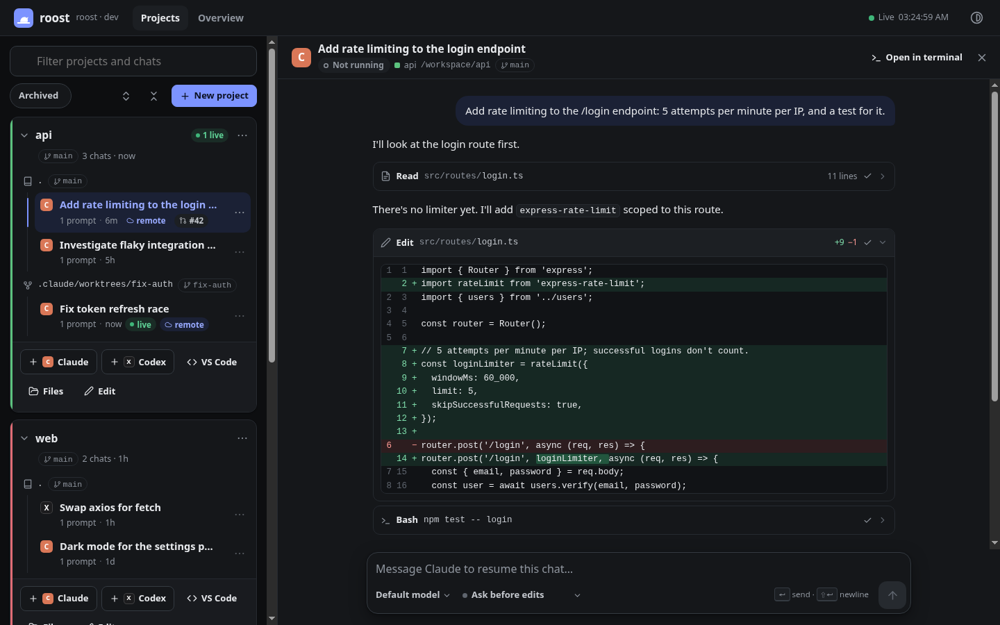
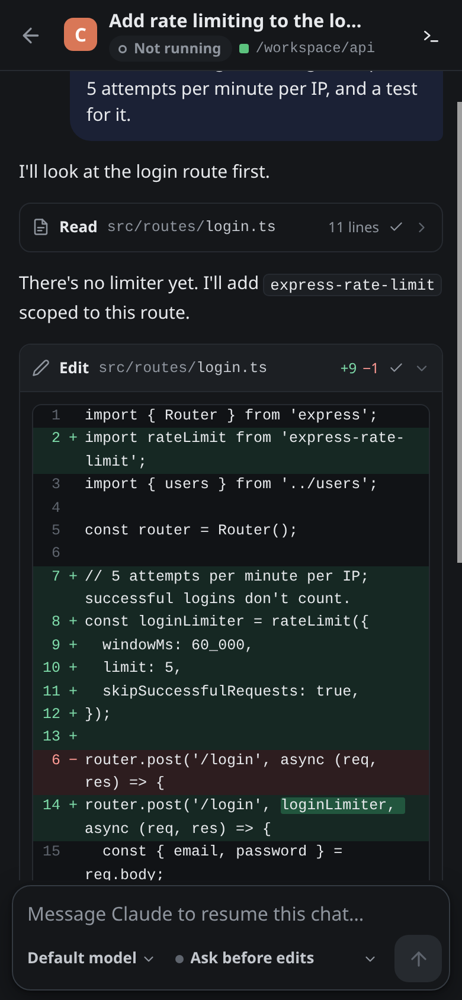
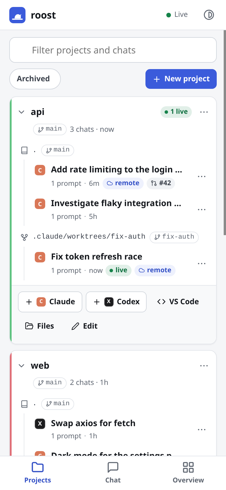
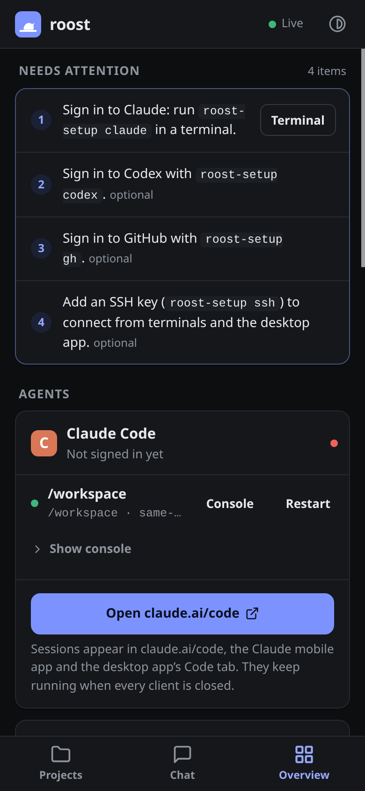

# roost

**An always-on home for Claude Code and Codex.** roost is one Docker container for your home server. Your agents keep working when your laptop is shut, and you can pick them up from any device.



<table>
  <tr>
    <td width="33%"></td>
    <td width="33%"></td>
    <td width="33%"></td>
  </tr>
  <tr>
    <td align="center">Chat</td>
    <td align="center">Projects</td>
    <td align="center">Overview</td>
  </tr>
</table>

<sub>Screenshots use demo data (<code>scripts/seed-demo.sh</code>, captured with <code>scripts/screenshots.mjs</code>).</sub>

- **A built-in chat interface for Claude and Codex**, designed mobile-first. Chats stream as they're written. Tool calls show as compact cards that expand to diffs, command output and file previews. Approvals appear inline (Allow / Always allow / Deny), so you can keep agents in ask-first mode and answer from your phone. Every chat is an ordinary Claude Code or Codex session, so you can also resume it in a terminal or in the official apps.
- **Projects**: a tree of everything in `/workspace` (project → repo / worktree / folder → chats), built from Claude's and Codex's own transcripts. File chats into projects, archive them, and start new ones anywhere.
- **Keys and secrets** for the agents: SSH keys for cloning and pushing, and tokens and API keys they get as environment variables. Values are write-only in the UI.
- **Claude Code Remote Control server.** Claude sessions run in the container. You drive them from [claude.ai/code](https://claude.ai/code), the Claude mobile app or the desktop app's Code tab. Nothing depends on your laptop being awake.
- **Codex** in persistent tmux sessions, plus the Claude and Codex extensions in VS Code.
- **VS Code in the browser** (code-server) for diffs, reviews, editing and image/media previews.
- **Web terminal** (ttyd + tmux). Close the tab and your shells keep running. Hold **Option** (macOS) or **Shift** while dragging to select text for copying.
- **File browser** for uploading, downloading, previewing and sharing files in the workspace.
- **A shared Chromium** that agents drive through the `browser` MCP (Playwright over CDP). You watch and take over through VNC in the browser, for CAPTCHAs, logins and the like.
- **SSH** (key only) for terminal clients and the desktop app's SSH connections.
- **No Docker socket, no `--privileged`.** If an agent wrecks the container, you recreate it. See [docs/sandboxing.md](docs/sandboxing.md).
- **Optional, limited access to the host's Docker.** A filtered proxy for status, logs and restarts, and a gate that deploys Compose stacks only from a branch you review. Neither gives the agents root on the host. See [docs/host-access.md](docs/host-access.md).

Everything sits behind one port (`7680`) and one login.

```
            ┌───────────────────────────── roost container ─────────────────────────────┐
 browser ──▶│ :7680 Caddy (basic auth) ─┬─ /        dashboard                           │
            │                           ├─ /code/   VS Code (code-server)               │
            │                           ├─ /term/   ttyd ─▶ tmux ─▶ bash/claude/codex   │
            │                           ├─ /files/  filebrowser                         │
            │                           └─ /vnc/    noVNC ─▶ x11vnc ─▶ Xvfb + Chromium  │
            │                                                        ▲ CDP :9222        │
 claude.ai, │ claude remote-control (tmux, watchdog) ── Playwright MCP ┘                │
 mobile and │ codex (tmux)                                                              │
 desktop ──▶│ :2222 sshd (keys only)                                                    │
            │ /config  (home, sign-ins, browser profile, logs)   /workspace (projects)  │
            └───────────────────────────────────────────────────────────────────────────┘
```

## Install

### Unraid

1. **Docker → Add Container → Template**, paste this template URL and apply it:
   `https://raw.githubusercontent.com/TheJoshGriffith/roost/main/unraid/roost.xml`
   (Or copy `unraid/roost.xml` to `/boot/config/plugins/dockerMan/templates-user/my-roost.xml`.)
2. Point **Workspace** at the share your projects live in. Only map what you want the agents to touch.
3. Start the container, then open the WebUI. The username is `roost` (not `root`). The generated password is in the container log (and in `appdata/roost/roost/secrets/web-password`). You can also set **Web UI password** yourself.

### Docker Compose

```bash
curl -O https://raw.githubusercontent.com/TheJoshGriffith/roost/main/docker-compose.yml
docker compose up -d && docker logs roost | grep password
```

## First run

Open the dashboard. A **Finish setting up** card lists what's left. In the dashboard's terminal:

```bash
roost-setup
```

This walks through git identity, GitHub CLI, Codex (device-code login) and Claude (`claude auth login`). After Claude signs in, the Remote Control server starts. **The first time, it asks `Enable Remote Control? (y/n)`**. Answer it from the dashboard's **Answer "y"** button or from the console.

After that, open [claude.ai/code](https://claude.ai/code), or the Claude app on your phone or desktop. Your roost sessions are listed there.

## Connecting

| From | How |
| --- | --- |
| Phone / tablet / any browser | claude.ai/code or the Claude app → your `roost · workspace` Remote Control session |
| Claude desktop app | The Remote Control session shows up in the Code tab. You can also add roost as an SSH host (`roost@<server>:2222`) |
| Terminal / Claude CLI | `ssh -p 2222 roost@<server>`, then `tmux attach -t rc-workspace` (Remote Control console), or run `claude` / `codex` |
| Codex | Dashboard → **Codex terminal** (persistent tmux session `codex`), the Codex extension in VS Code, or SSH |
| Files & diffs | Dashboard → **VS Code** or **Files** |
| The shared browser | Dashboard → **Browser** (noVNC), or the viewer panel. Set `ROOST_VNC_PASSWORD` to also expose raw VNC on 5900 |
| Web apps you're building | The dashboard's viewer panel (see below), or a project's ⋯ → **Preview a web server…** |

### Projects view

The dashboard opens on **Projects**: a tree of everything in `/workspace` (project → folder, repo or worktree → chats). Claude and Codex chats are discovered from their own transcripts, so chats started from claude.ai, the apps, the terminal or VS Code all show up. From there you can:

- see each chat's title, last activity, and whether it's live, open in a terminal, or was driven over Remote Control,
- read a chat's transcript, or **Resume** it (`claude --resume` / `codex resume`) in a persistent terminal,
- start a new Claude or Codex chat in any project, folder or worktree,
- **file chats** into projects by dragging them (or with *Move to…*), and **archive** ones you're done with,
- create projects by cloning a repo, making a folder, or grouping existing folders, then rename, colour and pin them,
- give a project its own Remote Control server (optionally one git worktree per session) from its Edit dialog.

Organising only changes roost's view. It's stored in `/config/roost/projects.json`, and Claude's and Codex's own files are never modified. It can't reorganise the chat lists inside claude.ai or the Claude apps.

### Keys and secrets

The **Secrets** tab gives the agents what they need to work with your repositories and services:

- **SSH keys.** Generate a key (or import one; a passphrase is removed so agents can use it) and say which hosts it's for, e.g. `github.com`. Copy the public key into GitHub or GitLab (an account key, or a repository's deploy key), then press **Test**. roost keeps a managed block in `~/.ssh/config`, so `git clone git@github.com:…` just works for agents, terminals and SSH sessions.
- **Secrets.** Named values such as `GH_TOKEN`, `HASS_TOKEN` or an API key, each with a description. They become environment variables in every chat, terminal, SSH session and Remote Control session. A token can also be used for **git over HTTPS** to a host. `GH_TOKEN` also signs in the GitHub CLI.
- **CLI tools.** `gh` (GitHub CLI) and `glab` (GitLab CLI) are installed, current versions kept up to date by CI. The Secrets page shows whether each is signed in. **Connect** stores a token for it, with links to create one with the right scopes, including for self-hosted GitLab. gh can also sign in with a one-time code in your browser.
- Agents see what's available, names and descriptions only, in a managed section of `~/.claude/CLAUDE.md` and `~/.codex/AGENTS.md`, and by running `roost-secrets`.

New chats, terminals and SSH sessions pick up changes immediately. Running chats, the Remote Control server and VS Code need a restart; the page has a button for Remote Control. Values are stored in roost's home directory (`/config/home/.config/roost/`, mode 600) and are never sent back to the browser. Agents can read anything they're able to use, though, so use narrowly scoped tokens. See [docs/sandboxing.md](docs/sandboxing.md).

### Attachments in chats

roost's chat box takes files and pictures. Attach them with the paperclip, paste them (e.g. a screenshot), or drop them on the message box. On a phone the paperclip offers the camera and photo library.

- **Pictures** (PNG, JPEG, GIF, WebP, up to 3.75 MB) go to the model directly, so Claude and Codex can see them. Other picture formats, such as HEIC, are passed as files.
- **Every file**, pictures included, is saved under `~/.local/share/roost/uploads/<date>/` and listed by path under your message. The agent can open it with its own tools (PDFs, logs, CSVs, archives…) or copy it into the project. Claude may read that folder without asking. Codex asks before running a command, as usual, unless you've chosen a more permissive mode.
- Attachments show up as thumbnails and chips in the chat, including when you reopen it later.
- Uploads are kept for 30 days (`ROOST_UPLOAD_KEEP_DAYS`). Files are limited to 100 MB each (`ROOST_UPLOAD_MAX_MB`).

### Plan usage

The **Overview** shows how much of your plan's usage windows you've used: for Claude the 5-hour and 7-day windows, plus any per-model weekly limit; for Codex, whatever windows its plan has. Each bar has a tick showing how much of the window has gone by, so a bar past its tick is running ahead of the allowance. The numbers cover the whole account, not just roost. They come from the same sources as Claude Code's `/usage` screen and Codex's rate-limit status, using roost's existing sign-ins. The Claude source is undocumented and may change. roost only reads Claude's sign-in token, never refreshes it; if the token has expired, the card says so until Claude next runs and renews it.

### Viewer: the browser and your web apps

The panel button in the app bar opens the **viewer**. It holds tabs for the shared browser (VNC) and any web server running inside roost, such as a dev server on `localhost:3001`. **+** lists what's listening, labelled by project folder. A project's ⋯ menu lists that project's own servers first. You can type in any port, even one whose server hasn't started yet. Its tab keeps retrying until the server answers.

The viewer docks on the right or along the bottom, with a draggable divider. It can also float as a window you drag by its tab bar and resize from the corner, or fill the window. On a phone it always fills the screen. Tabs keep their page while you switch between them, and **↗** opens the current one in a browser tab of its own.

Each web server is shown on a **preview port** of its own (`7700`–`7704`, set with `ROOST_PREVIEW_PORTS`). A sub-path such as `/preview/3001/` would break most apps, because they use root-relative URLs (`/api/…`, `/_next/…`, a WebSocket at `/`). So:

- **Publish the preview ports with the same numbers** on the host (`7700-7704:7700-7704`). The viewer links to `http://<the host you opened roost on>:7700`.
- Only people signed in to roost can open them. The dashboard sets an HttpOnly cookie, browsers send cookies to every port on the same host, and the preview ports refuse requests without it. The cookie is removed before the request reaches your app.
- Your app sees requests as `localhost:<its port>`, so dev servers that check the `Host` header work without changes. `X-Forwarded-Host` carries the real host. `X-Frame-Options` and CSP `frame-ancestors` are removed so the app can be shown in the panel.
- Preview ports are plain HTTP. If you reach roost through an HTTPS reverse proxy, browsers won't show http inside the https page. Use **↗** to open the preview in its own tab, or put a proxy on the preview ports too.
- When every preview port is in use, opening another server reuses the port that went longest without being opened.

### Multiple projects

By default, one Remote Control server serves `/workspace` and sessions start there. To give a project its own server, so that each session gets its own git worktree, add it to `/config/roost/rc-projects.conf`:

```
/workspace                 same-dir
/workspace/my-app          worktree   My App
```

The watchdog picks up changes within about 15 seconds. The Projects view's Edit dialog edits this file for you.

## Configuration

| Variable | Default | |
| --- | --- | --- |
| `ROOST_PASSWORD` | *(generated)* | Web UI password for user `roost` (`ROOST_USER`). `none` disables auth. Don't do that. |
| `ROOST_SSH_AUTHORIZED_KEYS` | | Comma- or newline-separated public keys |
| `ROOST_SUDO` | `true` | Passwordless sudo *inside* the container |
| `ROOST_NAME` | `roost` | Prefix for Remote Control session names |
| `ROOST_CLAUDE_PERMISSION_MODE` | | e.g. `acceptEdits` for Remote Control sessions |
| `ROOST_CLAUDE_RC_ARGS` | | Extra flags for `claude remote-control` |
| `ROOST_SCREEN` | `1600x900x24` | Virtual display size |
| `ROOST_VNC_PASSWORD` | | Also listen on `:5900` for native VNC clients |
| `ROOST_UPLOAD_MAX_MB` | `100` | Largest file you can attach in a chat |
| `ROOST_UPLOAD_KEEP_DAYS` | `30` | How long chat attachments are kept (`0` keeps them forever) |
| `ROOST_PREVIEW_PORTS` | `7700-7704` | Ports for showing web servers in the viewer (a range and/or a comma list). `off` turns previews off |
| `ROOST_BROWSER_FLAGS` | | Extra Chromium flags |
| `ROOST_SSH`, `ROOST_BROWSER`, `ROOST_CODE_SERVER`, `ROOST_FILES`, `ROOST_CLAUDE_RC` | `true` | Turn components off |
| `ROOST_UPDATE_ON_START` | `false` | `npm` update Claude Code / Codex at every start |
| `PUID` / `PGID` / `UMASK` / `TZ` | `1000`/`1000`/`002`/`Etc/UTC` | Unraid template uses `99`/`100` |

Ports: `7680` web, `2222` SSH, `7700`–`7704` web previews (publish with the same numbers), `5900` VNC (optional).
Volumes: `/config` (home directory, sign-ins, browser profile, logs), `/workspace` (projects).

## Updating and resetting

- **Images.** CI rebuilds daily with the latest Claude Code and Codex. Update the container in Unraid as usual. You can also set `ROOST_UPDATE_ON_START=true`.
- **The agent broke the system.** Recreate the container (Unraid: *Force update*, or remove and re-add). The image is rebuilt from scratch, and your home and workspace are kept.
- **The agent broke the home directory (dotfiles, tools in `~/.local`).** Stop the container and delete `appdata/roost/home`. Sign-ins live there too, so you'll run `roost-setup` again.
- **Start completely fresh.** Delete `appdata/roost`.

## Development

```bash
docker buildx build --load -t roost:dev .
./scripts/smoke-test.sh roost:dev
```

The image is built and published to `ghcr.io/thejoshgriffith/roost` by [.github/workflows/build.yml](.github/workflows/build.yml) on every push to `main`, on `v*` tags, and daily.
